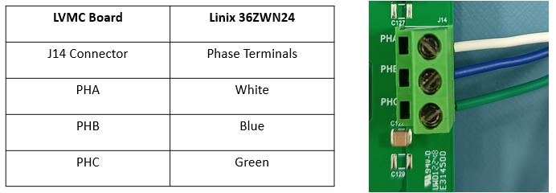
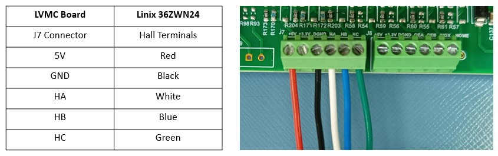
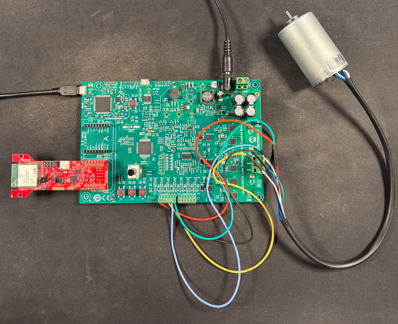
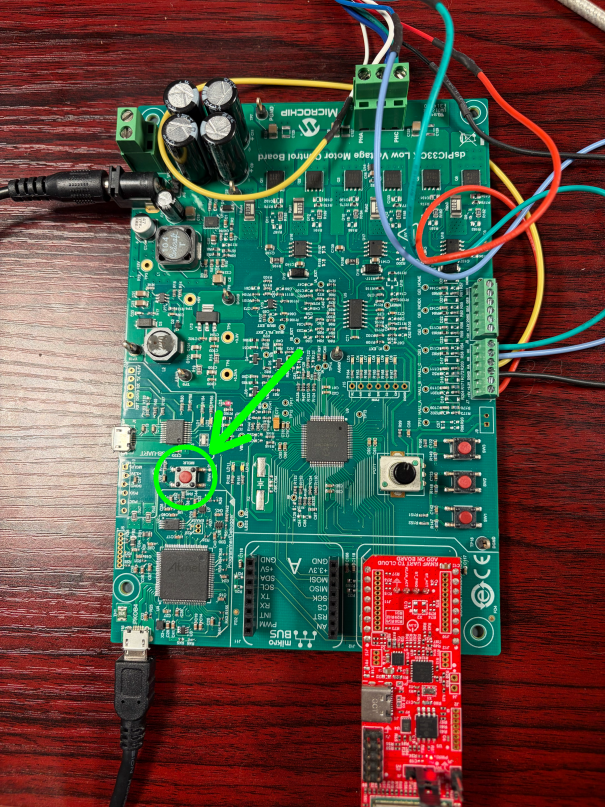
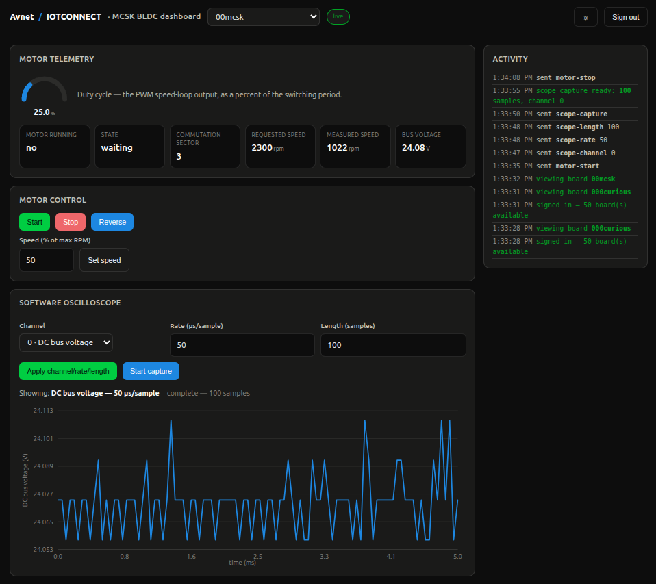

# dsPIC33CK256MP508 Motor Control Starter Kit + RNWF11 /IOTCONNECT Quickstart

A baremetal C quickstart connecting the Microchip **dsPIC33CK256MP508** (on
the **dsPIC33CK Motor Control Starter Kit**, running Microchip's AN957 BLDC
motor-control reference application, see
[`docs/AN957 Demo ReadMe MCSK.pdf`](firmware/dspic33ck256mp508_rnwf11_iotconnect.X/docs))
to [Avnet /IOTCONNECT](https://www.iotconnect.io/) using /IOTCONNECT's
[C SDK](https://github.com/avnet-iotconnect/iotc-c-lib), over the Microchip
**RNWF11 UART to Cloud Add-on Board**. No RTOS, no MQTT/TLS stack on the
MCU. The RNWF11 owns the WiFi/MQTT/TLS connection itself, using a
certificate and key stored on its own filesystem, and the dsPIC33 just
talks to it over UART with AT commands. While the motor control loop runs
in real time, the demo publishes live motor telemetry (run state, speed,
current, duty cycle, etc.) to /IOTCONNECT every 10 seconds.


## Table of Contents

1. [Prerequisites](#1-prerequisites)
2. [Get the Quickstart Source](#2-get-the-quickstart-source)
3. [Cloud Account Setup](#3-cloud-account-setup)
4. [Import the Device Template](#4-import-the-device-template)
5. [Generate and Upload the Device Certificate](#5-generate-and-upload-the-device-certificate)
6. [Create the Device in /IOTCONNECT](#6-create-the-device-in-iotconnect)
7. [Mount the RNWF11 on the Starter Kit](#7-mount-the-rnwf11-on-the-starter-kit)
8. [Connect the Motor](#8-connect-the-motor)
9. [Flash and Configure the Firmware](#9-flash-and-configure-the-firmware)
10. [Run the Demo](#10-run-the-demo)
11. [Resources](#11-resources)

## 1. Prerequisites

### Hardware

1. [dsPIC33CK Motor Control Starter Kit](https://www.microchip.com/en-us/development-tool/EV12F76A)

2. [RNWF11 UART to Cloud Add-on Board (EV12H55A)](https://www.microchip.com/en-us/development-tool/ev12h55a)
3. 1 micro-USB cable
4. 1 USB-C cable
5. A 2.4 GHz WiFi network

### Software

1. [MPLAB IPE](https://www.microchip.com/mplab/mplab-integrated-programming-environment),
   free, no compiler needed, just flashes the prebuilt `.hex` already in this repo
2. `openssl` on your `PATH` (already present on most Linux systems; on Windows it's included with [Git for Windows](https://git-scm.com/downloads/win), among other sources)
3. Either Python 3.9+ **or** PowerShell 5.1+ (Windows ships this by default; PowerShell 7+ also works on Linux) to run the provisioning scripts. Pick whichever you're more comfortable with, both do the same thing
4. A serial terminal (PuTTY, Tera Term, MPLAB Data Visualizer's terminal, etc.) to watch the device's console output
5. An [/IOTCONNECT](https://www.iotconnect.io/) account

> [!NOTE]
> Want to modify the firmware itself instead of just running the demo? See
> [developer.md](developer.md). Building from source needs MPLAB X IDE, the
> XC-DSC compiler, and the `dsPIC33CK-MP_DFP` device pack instead of IPE.

## 2. Get the Quickstart Source

Download each of the files below by opening its link, then clicking the
**Download raw file** button at the top right of the file viewing window.
Put them all in one new, empty folder on your PC. That's your working
directory for the rest of this guide.

1. Prebuilt firmware:
   [bin/quickstart/dspic33ck-lvmcb-rnwf11-iotconnect-demo.hex](bin/quickstart/dspic33ck-lvmcb-rnwf11-iotconnect-demo.hex)
2. Device template:
   [templates/dspic33MC-template.json](templates/dspic33MC-template.json)
3. Provisioning scripts for your host OS:
   - **Linux/macOS (Python)**:
     [tools/provision_rnwf11_cert.py](tools/provision_rnwf11_cert.py),
     [tools/provision_device_config.py](tools/provision_device_config.py),
     [tools/requirements.txt](tools/requirements.txt)
   - **Windows (PowerShell)**:
     [tools/provision_rnwf11_cert.ps1](tools/provision_rnwf11_cert.ps1),
     [tools/provision_device_config.ps1](tools/provision_device_config.ps1)

> [!NOTE]
> Prefer a full `git clone` instead? That works fine too, and is what you'll
> need anyway if you end up building the firmware from source, see
> [developer.md](developer.md).

## 3. Cloud Account Setup

An /IOTCONNECT account with an **AWS backend** is required. If you need to create an account, a
**free trial subscription** is available — no credit card required:

- Sign
  up: [https://subscription.iotconnect.io/subscribe?cloud=aws](https://subscription.iotconnect.io/subscribe?cloud=aws)
  (see
  the [AWS Marketplace option](https://github.com/avnet-iotconnect/avnet-iotconnect.github.io/blob/main/documentation/iotconnect/subscription/iotconnect_aws_marketplace.md)
  if you prefer)
- Log in: [https://console.iotconnect.io/login](https://console.iotconnect.io/login)

> [!NOTE]
> Be sure to check your SPAM folder for the temporary password after registering if you don't see
> it after a couple of minutes.

## 4. Import the Device Template

This demo publishes live motor telemetry and accepts motor control commands.
Import [`templates/dspic33MC-template.json`](templates/dspic33MC-template.json).

1. Log in at [console.iotconnect.io](https://console.iotconnect.io).
2. Open the **Device** module:

   

3. At the bottom of the page, click **Templates**:

   

4. Click **Create Template**:

   

5. Click **Import**, and select
   [`templates/dspic33MC-template.json`](templates/dspic33MC-template.json)
   you downloaded in Step 2:

   

## 5. Generate and Upload the Device Certificate

The RNWF11 board has its own USB-C port and power-select jumper
(`PC3V3` / `HOST3V3`), independent of the starter kit. This step uses it
standalone, **not** mounted on the starter kit yet.

Move the jumper to **PC3V3** and plug the RNWF11's USB-C port directly into
your PC.

<table>
  <tr>
    <td align="center"><br><b>PC3V3</b>, flashing/provisioning (this step)</td>
    <td align="center"><br><b>HOST3V3</b>, normal operation (Step 7)</td>
  </tr>
</table>

**Before running the command below**, find the serial port name it just
enumerated as, **the full path/name, not just the last part** (e.g.
`/dev/ttyACM0`, not `ttyACM0`):
- **Linux**: run `ls /dev/serial/by-id/` (or `dmesg | tail` right after
  plugging it in). Look for the RNWF11's MCP2200 USB-to-UART bridge, e.g.
  `/dev/ttyACM0`.
- **Windows**: open Device Manager &rarr; **Ports (COM & LPT)**. Look for
  "MCP2200 USB Serial Port Emulator" and note its `COMx` number (e.g. `COM6`).

This board's firmware expects the default filenames on the RNWF11's own
filesystem (`root-ca` / `device-cert` / `device-key`, set in
`iotconnect/iotconnect_rnwf11_config.h`), so the `--ca-name`/`--cert-name`/
`--key-name` flags can stay at their defaults.

From the folder you downloaded the files into in Step 2:

**Linux:**
```bash
pip3 install -r requirements.txt
curl -fsSLO https://www.amazontrust.com/repository/AmazonRootCA1.pem
```

Replace `MYPORTNAME` with the port you found above, and `MYUNIQUEID` with a
Unique ID of your own choosing for this device, pick something memorable,
e.g. `my-desk-dspic33ck`. You'll reuse whatever you pick later, both when
creating the device in /IOTCONNECT and when resolving connection info.
```bash
python3 provision_rnwf11_cert.py --port MYPORTNAME --duid MYUNIQUEID --ca-cert-path AmazonRootCA1.pem
```

**Windows (PowerShell):**
```powershell
Invoke-WebRequest https://www.amazontrust.com/repository/AmazonRootCA1.pem -OutFile AmazonRootCA1.pem
```

Replace `MYPORTNAME` with the port you found above, and `MYUNIQUEID` with a
Unique ID of your own choosing for this device, pick something memorable,
e.g. `my-desk-dspic33ck`. You'll reuse whatever you pick later, both when
creating the device in /IOTCONNECT and when resolving connection info.
```powershell
.\provision_rnwf11_cert.ps1 -Port MYPORTNAME -Duid MYUNIQUEID -CaCertPath AmazonRootCA1.pem
```

This generates a self-signed device certificate, prints it to the terminal,
and uploads the CA cert, device cert, and device key to the RNWF11's own
filesystem via `AT+FS`. You'll paste the printed device certificate into the 
/IOTCONNECT console in the next step.

> [!NOTE]
> This can take up to 60 seconds to finish depending on your host PC environment.

## 6. Create the Device in /IOTCONNECT

1. After logging into your /IOTCONNECT account on
   [console.iotconnect.io](https://console.iotconnect.io), go to the
   **Device** page and click **Create Device**:

   

2. Set the Unique ID and Device Name:

   

   - **Unique ID**: must be the **exact same** `MYUNIQUEID` value you passed
     to `provision_rnwf11_cert.py`/`.ps1` earlier. This is the DUID, and
     it's what ties everything together.
   - **Device Name**: a separate display name shown in the
     /IOTCONNECT console with looser character constraints (e.g. can use spaces)

3. Select your **Entity**:

   

4. Select the template you imported earlier in
   [Step 4](#4-import-the-device-template):

   

5. Under **Device certificate**, choose **Use my certificate**, and paste
   the certificate PEM that `provision_rnwf11_cert.py`/`.ps1` printed:

   

6. Click **Save & View**.

## 7. Mount the RNWF11 on the Starter Kit

Move the RNWF11's power jumper back to **HOST3V3**.

> [!IMPORTANT]
> The RNWF11 goes in **mikroBUS/Click socket B**, not A. Per
> `iotconnect/iotconnect_rnwf11_config.h`: *"UART2 is routed to the mikroBUS
> B header, where the RNWF11 is seated."*


## 8. Connect the Motor

With the board unpowered, connect the included motor's wires to the board's
two green terminal blocks following the pinout below from
Microchip's [AN957 Demo ReadMe MCSK.pdf](firmware/dspic33ck256mp508_rnwf11_iotconnect.X/docs).

1. Connect the 3 thick phase wires to connector **J14**:

   | J14 terminal | Wire color |
   |---|---|
   | PHA | White |
   | PHB | Blue |
   | PHC | Green |

   

2. Connect the 5 thin Hall sensor wires to connector **J7**:

   | J7 terminal | Wire color |
   |---|---|
   | 5V | Red |
   | GND | Black |
   | HA | White |
   | HB | Blue |
   | HC | Green |

   

> [!NOTE]
> The motor's wires may not all comfortably reach their terminals depending
> on how your board and motor are positioned so you may need to solder on
> extensions for some of them.

## 9. Flash and Configure the Firmware

Connect the board's power supply, and connect the included micro-USB cable
between your PC and the board's **PKOB4** port. The RNWF11 stays mounted
from Step 7.



You already have the ready-to-flash
[`bin/quickstart/dspic33ck-lvmcb-rnwf11-iotconnect-demo.hex`](bin/quickstart/dspic33ck-lvmcb-rnwf11-iotconnect-demo.hex)
from Step 2. No compiler, no opening the firmware project.

1. Open **MPLAB IPE**. Under **Device**, select **dsPIC33CK256MP508**; under
   **Tool**, select the connected **PKOB4** (listed as something like
   *Curiosity/Starter Kits (PKOB4)*), then click **Connect**.
2. Under **Browse**, select
   [`bin/quickstart/dspic33ck-lvmcb-rnwf11-iotconnect-demo.hex`](bin/quickstart/dspic33ck-lvmcb-rnwf11-iotconnect-demo.hex)
   you downloaded in Step 2.
3. Click **Program**.
4. Press the board's **MCLR** button (the small red pushbutton near the
   PKOB4 micro-USB port, circled below):

   

> [!IMPORTANT]
> Always press **MCLR** after programming, even if IPE reports "Programming/
> Verify complete" and "Release From Reset mode is enabled." Confirmed on
> real hardware: the debugger can leave the board sitting in reset
> afterward regardless of what the log says, and a DC power-cycle alone
> doesn't reliably fix this either (PKOB4 is powered over its own USB
> connection, independent of the board's supply, and can keep holding the
> chip in reset through a power-cycle of the board itself). Pressing MCLR
> is the only way confirmed to reliably get the firmware actually running
> at this point. Don't skip it, even if the next step seems to work
> without it.

This binary ships unprovisioned. It has no WiFi or /IOTCONNECT credentials
built in, so it won't connect to anything yet on its own. `provision_device_config.py`/`.ps1`
pushes those **live, over the same serial connection**, straight into a
dedicated flash page the firmware reads at boot, no rebuild needed since
there's nothing to rebuild here. `--port`/`-Port` is what makes that happen,
so it's required for this path (it's optional if you're building from
source instead, see [developer.md](developer.md)):

**Linux:**
```bash
python3 provision_device_config.py --wifi-ssid MYSSID --wifi-password MYPASSWORD --cpid MYCPID --env MYENVIRONMENT --duid MYUNIQUEID --port /dev/ttyACM0
```

**Windows (PowerShell):**
```powershell
.\provision_device_config.ps1 -WifiSsid MYSSID -WifiPassword MYPASSWORD -Cpid MYCPID -Env MYENVIRONMENT -Duid MYUNIQUEID -Port COM5
```

Replace `MYSSID`/`MYPASSWORD` with your real WiFi credentials,
`MYCPID`/`MYENVIRONMENT` with the values under **Settings &rarr; Key
Vault** in the /IOTCONNECT console, `MYUNIQUEID` with the same Unique ID you
used in Steps 5 and 6, and the port with your board's actual serial port
(e.g. `/dev/ttyACM0` on Linux, `COM5` on Windows).

Once the script prints "Device confirmed: OK", press **MCLR** once more
(the same button pictured above). Confirmed on real hardware as the
reliable way to get a clean reconnect using the newly-saved config. Skip
ahead to [Run the Demo](#10-run-the-demo).

> [!WARNING]
> If you ever reflash via MPLAB IPE again after provisioning (e.g. to
> update to a newer `.hex`), it erases the **entire** chip, not just the
> program code. This wipes the saved WiFi/IOTCONNECT config right along
> with it, even though that config lives in its own separate flash page
> outside the program memory range IPE reports programming. You'll need to
> run the provisioning script again afterward; there's no way to reflash
> without losing it.

> [!TIP]
> Want to modify the firmware itself instead (motor control parameters, the
> oscilloscope feature, telemetry fields, etc.)? See
> [developer.md](developer.md) for building from source.

## 10. Run the Demo

To watch the boot log, open a serial terminal at 115200 8-N-1.

> [!NOTE]
> The micro-USB connection can stay on the PKOB4 port on the board for connecting to the 
> serial console. The firmware routes the serial communications through this port to 
> prevent users from needing to swap their USB connection between ports on the board.

Once connected, the firmware publishes live motor telemetry to /IOTCONNECT
every 10 seconds:

```json
{"run": 1, "st": 3, "sec": 4, "rpm": 2300, "spd": 2287, "ic": 0, "im": 12, "duty": 9821, "vdc": 15234}
```

(`run` = motor running, `st` = state machine state, `sec` = commutation
sector, `rpm`/`spd` = requested/measured speed, `ic`/`im` = requested/measured
current, `duty` = PWM duty cycle, `vdc` = DC bus voltage ADC reading, multiply by
0.002176 for volts, e.g. 11064 is about 24.1 V.) You can watch it
arrive on the device's **Live Data** tab in the /IOTCONNECT console, but the
web dashboard below is the recommended way to see it.

### Using the Web Dashboard



You can use this AWS-hosted dashboard to view telemetry live, send motor/oscilloscope
commands, and plot scope capture as a charts. Open
[the dashboard](https://7qh4y68kpa.execute-api.us-east-1.amazonaws.com) and
sign in with your own /IOTCONNECT solution key, environment, email, and
password (each person uses their own /IOTCONNECT login, nothing is shared or
stored beyond your signed-in session).

From there:
- The **telemetry** panel shows the fields above, live, updating every few
  seconds.
- The **motor control** panel sends `motor-start`/`stop`/`reverse`/`speed`.
- The **oscilloscope** panel sets the channel/rate/length, triggers a
  capture, and plots the result as soon as it's done publishing, no copying
  chunk lines anywhere.

Both panels validate their inputs client-side before sending, with range
hints shown right in the UI.

> [!NOTE]
> This dashboard is already deployed and hosted. You don't need an AWS account
> or any setup to use it. The same `motor-*`/`scope-*` commands its buttons
> send can also be sent directly from the /IOTCONNECT console, and the
> oscilloscope's raw published data (chunked JSON arrays) can be read
> directly from /IOTCONNECT if you want to process it yourself instead of
> using the dashboard. See [developer.md](developer.md) for the full command
> reference, wire format, engineering-unit conversions, and suggested
> capture settings for this motor.

## 11. Resources

- [developer.md](developer.md), covering building the firmware from source, the full C2D command reference, oscilloscope wire format, engineering-unit conversions, and suggested capture settings. Not needed just to run the demo.
- [dashboard/README.md](dashboard/README.md), the web dashboard's own documentation (architecture, design decisions) for whoever maintains or redeploys it. Not needed just to use it.
- [AN957 Demo ReadMe MCSK.pdf](firmware/dspic33ck256mp508_rnwf11_iotconnect.X/docs), Microchip's motor-control reference application this quickstart is built on
- [iotc-mchp-dspic33-curosity-rnwf11](https://github.com/avnet-iotconnect/iotc-mchp-dspic33-curosity-rnwf11), a related /IOTCONNECT quickstart for the dsPIC33AK512MPS512 Curiosity board, using the same RNWF11 add-on board
- [RNWF11 UART to Cloud Add-on Board User's Guide](https://ww1.microchip.com/downloads/aemDocuments/documents/WSG/ProductDocuments/UserGuides/RNWF11-UART-to-Cloud-Add-on-Board-User-Guide-DS50003638.pdf)
- [RNWF11 Application Developer's Guide](https://onlinedocs.microchip.com/oxy/GUID-209426F5-2F78-4B3F-80A0-AD79A119381E) (AT command reference)
- [iotc-c-lib](https://github.com/avnet-iotconnect/iotc-c-lib), /IOTCONNECT's C SDK
